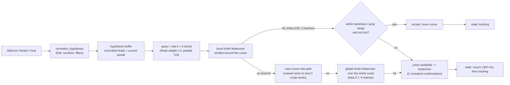

# Aligner algorithm

Code: `crates/zt-align`. The aligner is pure and deterministic. It performs no I/O, reads no clock and has no dependencies (`serde` is optional behind the `serde` feature). Time enters only as the `t_ms` argument of `VoiceTracker::handle`.

> Every number on this page is taken from the source (`tracker.rs`, `sw.rs`, `normalize.rs`, `similarity.rs`, `index.rs`). If you retune a default, update this page in the same change.

## Pipeline



The output of the tracker (`TrackerOutput { state, cursor_token, confidence, rate_wps }`) is mapped by the app to `zt_core::VoiceSignal`.

## 1. Normalization (`normalize.rs`)

Script words and hypothesis words go through the same normalization so they can be compared.

- **Case and diacritics.** Lowercase, then folding: `ä`/`æ` to `ae`, `ö`/`œ` to `oe`, `ü` to `ue`, `ß` to `ss`, and accented Latin letters to their base letter (`é` to `e`, `ñ` to `n`, `ł` to `l`, and so on). "Straße" and "Strasse" become identical.
- **Joiners.** Apostrophes (`'`, `’`, `` ` ``, `´`) and hyphens (`-`, U+2010, U+2011, soft hyphen) are removed without splitting: "geht's" becomes `gehts`, "E-Mail" becomes `email`.
- **Other punctuation splits words.** A few symbols are spoken: `%` becomes `prozent` or `percent`, `&` and `+` become `und` or `and`, `€` becomes `euro`, `$` becomes `dollar`.
- **Numbers.** A run of ASCII digits is expanded to number words in the selected `Lang`. German produces one compound word folded to ASCII (for example "2026" becomes `zweitausendsechsundzwanzig`, and years 1100 to 1999 are read "neunzehnhundert...") while English produces several words (`two thousand twenty six`). The thousands separator (`.` in German, `,` in English) is recognized when followed by exactly three digits. Numbers of 1 000 000 or more, or digit strings longer than 7 characters, are spelled digit by digit.
- **Fillers** (`aeh`, `aehm`, `aem`, `oehm`, `ehm`, `hm`, `hmm`, `mhm`, `uh`, `uhm`, `um`, `umm`, `erm`, `er`, `ah`) are removed **only from hypotheses** (`normalize_hypothesis`), never from the script.

`ScriptIndex` stores the normalized script words (`words`) and, for each, the token it came from (`owner`). One token can yield several words (numbers) or none (cues, symbols that normalize to nothing). `norm_of_token(token)` returns the first normalized word of a token; for a cue it returns the next spoken word. `token_of(norm)` maps back. The index is built from `Script::spoken_tokens()`, so cues never enter the index.

The language is chosen per script: the app maps `settings.language` starting with `en` to `Lang::En` and everything else to `Lang::De` (`appcore::lang_of`).

## 2. Word similarity (`similarity.rs`)

`word_similarity(a, b)` returns a value in [0, 1]:

- identical words: 1.
- if either word has fewer than 4 characters, **or** the first letters differ: the Levenshtein ratio only, `1 - distance / max_len`. This keeps "und" and "uns", or "haus" and "maus", from counting as matches (Jaro-Winkler is generous to a single changed first letter).
- otherwise: the maximum of the Levenshtein ratio and Jaro-Winkler. This tolerates the ending errors that speech recognizers produce (for example "teleprompta").

Levenshtein, Jaro and Jaro-Winkler are textbook implementations in this crate. Jaro-Winkler uses a prefix scale of 0.1 and a prefix length of up to 4.

## 3. Windowed Smith-Waterman (`sw.rs`)

`align(query, reference, range, expected, &SwParams) -> Option<SwHit>` locally aligns the query (the last `k` hypothesis words, each with a weight) against `reference[range]`.

For query word `i` and reference word `j`:

```text
sim      = word_similarity(q_i, r_j)
is_match = sim >= sim_threshold
s        = match_score * sim * weight   if is_match, else mismatch
H[i][j]  = max(0,
               H[i-1][j-1] + s,          # diagonal
               H[i-1][j]   + gap_hyp,    # extra spoken word (ad-lib, insertion)
               H[i][j-1]   + gap_script) # script word skipped
```

Parameters (`SwParams::default()`):

| Parameter | Default | Meaning |
|---|---|---|
| `sim_threshold` | 0.8 | Minimum word similarity to count as a match |
| `match_score` | 2.0 | Score of a perfect match (scaled by similarity and weight) |
| `mismatch` | -1.5 | Score of a non-matching pair |
| `gap_script` | -1.0 | A script word the speaker skipped |
| `gap_hyp` | -1.0 | An extra spoken word |
| `distance_penalty` | 0.01 | Tie-break: subtracted per word of distance between the end cell and the `expected` position |
| `max_trailing` | 1 | The alignment must end on one of the last `1 + max_trailing` query words |

Details that matter:

- **Valid end cells** are only cells that end in a match, with `val > 0`, and where `i + max_trailing >= k` (a recent query word). The best end cell maximizes `score - distance_penalty * |ref_idx - expected|`. Old context words at the start of the query therefore cannot outvote what the speaker is saying now.
- **Path tracking.** Alongside the score matrix the function keeps the number of matched pairs (`matches`) and the first query row of the path (`start`). Ties between the three moves prefer diagonal, then `gap_hyp` (up), then `gap_script` (left).
- **Confidence** is `score / max_possible`, clamped to [0, 1], where `max_possible` sums `match_score * weight` over the query suffix **starting at the alignment's first row**. Older context words (or ad-libs before the aligned part) therefore do not dilute a fresh match, while unmatched words at the end do.
- **Cost** is O(k * w). For k = 6 and w = 70 that is about 420 cells per call.

## 4. Tracker and hysteresis (`tracker.rs`)

`VoiceTracker::handle(event, t_ms)` is the only mutating entry point (besides `set_index`, `set_config` and the `resync` convenience wrapper).

### Configuration (`TrackerConfig::default()`)

| Field | Default | Meaning |
|---|---|---|
| `window_before` / `window_after` | 10 / 60 | Local search window in normalized words around `expected = cursor + 1` |
| `k` | 6 | Query length |
| `theta` / `min_matches` | 0.55 / 2 | Local acceptance thresholds |
| `theta_global` / `min_matches_global` | 0.7 / 4 | Global search thresholds |
| `jump_words` | 18 | A local hit further than this ahead of `expected` is a jump (about 3 lines at ~6 words per line) |
| `backtrack_words` | 10 | A hit up to this far behind the cursor is accepted at once |
| `jump_confirmations` | 2 | Consistent jump candidates required |
| `jump_tolerance` | 4 | Two candidates are "the same jump" within this many words (see below) |
| `lost_timeout_ms` | 4000 | Accumulated speech time without a match before `lost` (from `settings.lost_timeout_ms` in the app) |
| `resync_ease_ms` | 300 | Duration of the `resync` state |
| `manual_override_ms` | 2000 | Hypotheses ignored after a manual seek (from `settings.manual_override_ms` in the app) |
| `final_weight` / `partial_weight` | 1.0 / 0.8 | Query word weights |
| `near_words` | 2 | Near-cursor fast path width; 0 disables it |
| `sw` | `SwParams::default()` | |
| `resync` | `ResyncConfig::default()` | See below |

### `on_hypothesis`

1. Normalize the text. A **final** is appended to the committed buffer (trimmed to `3 * k` words) and clears the partial. A **partial** replaces the previous partial. The query is the last `k` words of committed plus partial. If the query text equals the previous query, nothing happens.
2. **Local search.** Align in `[expected - 10, expected + 60)` (clamped to the script). A hit counts only if `confidence >= theta` and `matches >= min_matches`. A local hit is a **jump** when the state is `lost`, or when it ends more than `backtrack_words` behind the cursor, or more than `jump_words` ahead of `expected`. Otherwise it is accepted immediately (`accept`).
3. **Near-cursor fast path** (ADR-007), only if the newest query word changed and there was no local hit: when a cursor exists and the state is `tracking`, `hold` or `resync` (never `listening` or `lost`), the newest word may advance the cursor if it matches one of the next `near_words + 1` (three) script words. `near_word_match` is strict: identical, or both words at least 5 characters, lengths within 2 and Levenshtein distance at most 1. The synthetic hit gets `confidence = max(theta, 0.9 * previous confidence)`, capped at 1. This lets the first word after a seek move the cursor without waiting for a second matching word.
4. **Global search.** If the query has at least `min_matches_global` words, align over the whole script with `theta_global` and `min_matches_global`. A hit becomes a jump candidate.
5. If nothing matched and the state is `tracking`, it changes to `hold`.

### Jump hysteresis (`consider_jump`)

A candidate is **consistent** with the pending one if `hit.end + jump_tolerance >= pending.pos` and `hit.end <= pending.pos + 2 * jump_tolerance`. The count increments for consistent candidates and restarts at 1 otherwise. When the count reaches `jump_confirmations` (2), the jump executes: the state becomes `resync` for `resync_ease_ms` (300 ms), the rate estimate is not computed across the jump, and the cursor moves (`accept`). Until then the state is `hold` (if it was `tracking`).

### Speaking rate

On each accepted forward hit, the instantaneous rate is `(end - previous_end) / dt` in normalized words per second. The estimate is an exponential moving average, `0.8 * old + 0.2 * new`, seeded with the first value. No rate sample is taken across a jump, re-anchor or manual seek (`last_match` is cleared), and the unit is normalized words (a number counts as several).

### Time-driven transitions (`on_time`)

- `resync` returns to `tracking` once `t_ms >= resync_until`.
- `tracking` or `hold` becomes `lost` when `nomatch_speech_ms > lost_timeout_ms`. `nomatch_speech_ms` accumulates only while `speech` is true (set by a hypothesis or `VadSpeech`, cleared by `VadSilence`) and the state is not `idle`. Any accepted match resets it. Long silence alone never makes the tracker `lost`.

### State machine

| From | Event | To |
|---|---|---|
| `idle` | `Start` | `listening` |
| `listening` | accepted match | `tracking` |
| `tracking` | accepted match | `tracking` |
| `tracking` | `VadSilence`, or hypothesis without match | `hold` |
| `hold` | accepted match | `tracking` |
| `tracking` / `hold` | speech time without match above `lost_timeout_ms` | `lost` |
| any non-idle | confirmed jump (including from `lost`, where any local hit is a jump candidate) | `resync` |
| `resync` | after `resync_ease_ms` | `tracking` |
| any | `Stop` | `idle` |
| any non-idle | `ManualSeek` | `hold`, hypotheses ignored for `manual_override_ms` |

`ManualSeek` places the cursor at the first normalized word of the token (the next spoken word for a cue), clears the hypothesis buffer and the rate memory. Events other than `Start`/`Stop` are ignored while `idle`.

## 5. Offline resync (`apply_resync`, ADR-006)

The optional offline engine decodes a finished speech segment and delivers it as `TrackerEvent::Resync { text, age_ms }`. Its text is more reliable than streaming partials, so it is searched in a much wider window and applied without jump confirmation.

`ResyncConfig::default()`: window 80 words behind and 400 ahead of `expected`, query = last 16 words, `theta = 0.6`, `min_matches = 4`, `deadband_words = 3`, `lag_words = 15`, and `SwParams { max_trailing: 3, .. }` (the VAD may clip the end of the segment).

- Ignored if a manual override is active, the index is empty, or the text normalizes to nothing.
- If the wide-window search finds nothing and the state is `lost` or `listening`, a global search runs with `theta = max(resync.theta, theta_global)`.
- The result describes **past** speech. With `lag = lag_words + ceil(rate_wps * age_ms / 1000)`, a hit that ends at most `deadband_words` ahead of the cursor and at most `lag` behind it **confirms** streaming (`ResyncOutcome::Confirmed`). Anything else **re-anchors** the cursor (`Reanchored { from, to }`), clears the buffer, and enters `resync` for 300 ms.
- Outcomes: `Ignored`, `NoMatch`, `Confirmed`, `Reanchored`.

## Origin

The treatment of backward and forward jumps (small backtracks accepted at once, large jumps only after confirmation) and the categories of the scenario tests follow the approach of **EdNutting/autocue** (MIT). The implementation was written from the description; no code was copied (see `THIRD_PARTY_NOTICES.md`). The near-cursor fast path takes an idea from **ShayneP/local-teleprompter** (MIT), also re-implemented (see [ADR-007](../adr/index.md)). Levenshtein, Jaro-Winkler and Smith-Waterman follow their textbook definitions.

## Tuning

Expected values in `crates/zt-testkit/src/fixtures.rs` were derived by hand from the algorithm. If a parameter change breaks a scenario, re-derive the expected value instead of just updating it. The unit tests in `tracker.rs` (`near_fast_path_*`, `near_word_match_rules` and the resync tests) pin the fast path and resync behavior.
