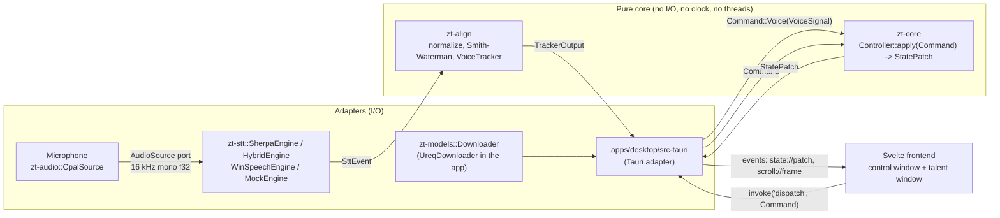
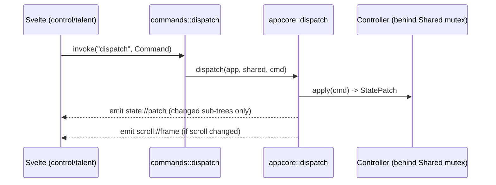

# Architecture

> Diagrams on this page use [Mermaid](https://mermaid.js.org/). The book configuration (`docs/book/book.toml`) does not yet enable a Mermaid preprocessor such as `mdbook-mermaid`, so without one the diagrams render as plain code blocks. They remain readable as text.

The architecture follows [ADR-005](../adr/index.md): a **hexagonal (ports and adapters) design** around a pure core that performs no I/O and reads no clock. Everything that touches the outside world (microphone, speech engines, network, files, windows) sits in an adapter behind a trait, or in the Tauri app crate.

## Workspace layout

| Crate | Role | Depends on (workspace) |
|---|---|---|
| `zt-core` | Domain core: `Command`, `Controller`, `AppState`, script model, playback state machine, settings, latency statistics | none |
| `zt-align` | Pure speech-to-script alignment: normalization, fuzzy similarity, windowed Smith-Waterman, `VoiceTracker` | none |
| `zt-audio` | Audio capture port, cpal adapter, channel selection, resampling, gain/AGC, speech-onset detector | none |
| `zt-stt` | Speech-recognition ports, sherpa-onnx adapters, hybrid streaming + resync orchestrator, Windows speech adapter, mocks | `zt-audio` |
| `zt-models` | Model manifest, install layout, integrity checks, `Downloader` port (no network code) | none |
| `zt-testkit` | Test helpers only (`publish = false`) | `zt-core`, `zt-align`, `zt-stt` |
| `zero-teleprompter` (`apps/desktop/src-tauri`) | Tauri 2 adapter: shared state, tick loop, voice thread, IPC commands, persistence, hotkeys, diagnostics | all of the above |

`zt-core` deliberately does **not** depend on `zt-align`. The app translates a `zt_align::TrackerOutput` into a `zt_core::VoiceSignal` (see `appcore::apply_tracker_output`).

The workspace `default-members` list only the six library crates, so a plain `cargo test` needs neither a WebView nor system audio libraries. The app crate belongs to the workspace but is built with `--workspace` or `-p zero-teleprompter`.

## Layers

## Rules

1. **`zt-core` and `zt-align` have no I/O, thread or clock dependencies.** Time enters only as an explicit parameter: `Command::Tick(dt_ms)` for the controller and `t_ms` in `VoiceTracker::handle`. This keeps every edge case deterministic and unit-testable.
2. **`zt-core` does not know `zt-align`.** The app converts `TrackerOutput` to `VoiceSignal`.
3. **One mutation path.** Every source (UI, in-app shortcut, global hotkey, tick loop, voice thread) ends in `appcore::dispatch` or, for voice output, `appcore::apply_tracker_output`. Both go through `Controller::apply` behind a **single mutex** (`Shared`, a wrapper around `Arc<Mutex<AppCore>>`). `Shared::lock` ignores mutex poisoning (`unwrap_or_else(|e| e.into_inner())`) because the core is plain data and `Controller::apply` is all-or-nothing.
4. **Adapters sit behind Cargo features.** In `zt-audio`, `cpal` is optional. In `zt-stt`, `sherpa` and `winspeech` are optional. In the app, `default = ["cpal", "download"]`, with `sherpa` and `winspeech` opt-in. Without them, mock implementations remain. Core tests and the default CI jobs need neither microphone nor model nor GUI.
5. **Rust is the single source of truth.** The frontend holds a copy of `AppState` that it updates from `state://patch` events. It owns only pure UI preferences (`ui-prefs.json`) and layout (pixels).
6. **Layout belongs to the frontend.** The core computes in token units (`scroll.position` is a fractional token index). The frontend maps tokens to pixels and reports the rendered line count and script version through the `report_layout` command. The app stores it and echoes it as `layoutLines` in `scroll://frame` events while the script version still matches.

## Threads in the app

| Thread | Name | Responsibility |
|---|---|---|
| Tauri main thread | | Windows, IPC commands, global shortcut callbacks |
| Tick loop | `zt-tick` | Sleeps 16 ms per iteration, measures `dt` (clamped to 1..250 ms), applies `Command::Tick(dt)`, feeds `TrackerEvent::Tick` when voice is enabled, emits `scroll://frame` |
| Voice thread | `zt-voice` | Builds the speech engine, opens the microphone **inside the thread** (`cpal::Stream` is not `Send` on some platforms), runs gain, engine and tracker. Runs under `catch_unwind`; a panic is reported through `diag::report_error` |
| cpal callback | (audio backend) | Resamples and forwards frames with `try_send` into a bounded `sync_channel` (capacity 64). Never blocks |
| Resync worker | `zt-resync` | Created by `HybridEngine::with_resync`. Decodes finished speech segments with the offline model |
| Windows speech | `zt-winspeech` | All WinRT objects of `WinSpeechEngine` live here (feature `winspeech`, Windows only) |
| Model download | `zt-model-dl` | Spawned per `models::install`. Downloads the model (and missing helper VAD models), emits `models://progress` at most every 100 ms |

## Windows (Tauri)

| Label | Page | Role | Capabilities file |
|---|---|---|---|
| `control` | `index.html` (frontend entry `control.ts`, component `App.svelte`) | Operator UI: editor, transport, settings, diagnostics | `capabilities/control.json` |
| `talent` | `talent.html` (frontend entry `talent.ts`, component `Talent.svelte`) | Render-only prompter output, created hidden | `capabilities/talent.json` |

- Closing the **talent window** only hides it (`api.prevent_close`, fullscreen off, `Command::SetFullscreen(false)`) and emits the `talent://visibility` event (`commands::EV_TALENT`, payload `false`) so the control window can update its toggle.
- Closing the **control window** stops voice and quits the app (`app.exit(0)`).
- Both windows subscribe to the same events. The content-security policy in `tauri.conf.json` is `default-src 'self'; script-src 'self'; style-src 'self' 'unsafe-inline'; img-src 'self' data:; font-src 'self' data:; connect-src ipc: http://ipc.localhost`.
- On macOS, `tauri.macos.conf.json` swaps the control window to native decorations with an overlay title bar. On other platforms the control window is undecorated (`decorations: false`) and draws its own window controls (`WindowControls.svelte`).

## Two interaction loops

The second loop is the voice loop, described in [Data flow](dataflow.md).

## Design decisions worth knowing

- **Why the controller is tick-driven:** scrolling speed, countdown and the voice-override timer all advance only through `Command::Tick`. Tests can therefore simulate minutes of playback in microseconds (`zt_testkit::builders::run_for`).
- **Why `StatePatch` flags sub-trees:** the app serializes only the changed top-level fields (`script`, `playback`, `scroll`, `voice`, `output`, `settings`) in `patch_json`. This keeps IPC small at 60 Hz.
- **Why the tracker is only reconfigured on relevant settings changes:** `dispatch` compares the derived `TrackerConfig` with the running one and calls `set_config` only on a difference, because re-creating the tracker on every theme or font change would reset cursor and state mid-take.
- **Why no silent demo fallback:** see [ADR-007](../adr/index.md). A model that fails to load yields an explicit error state, never a demo engine that scrolls on its own.
