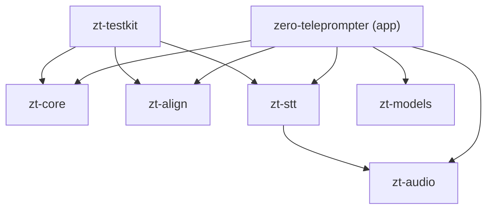

# Crates and APIs

This page lists the public surface of each crate as it exists in the source. It is a map, not a replacement for `cargo doc`; exact signatures are in the files named below. Items marked **(unverified)** could not be confirmed from the source alone.

## Workspace

- `Cargo.toml` at the repository root: `resolver = "2"`, edition 2021, `rust-version = "1.80"`, license `MIT OR Apache-2.0`, version `0.1.0`.
- `default-members` contain only the six library crates. A plain `cargo test` therefore builds no WebView or system-library dependency. The app crate is built with `--workspace` or `-p zero-teleprompter`, and it needs `apps/desktop/dist` because `tauri::generate_context!` embeds the frontend.
- Lints (`[workspace.lints]`): `unsafe_code = "forbid"`, `missing_debug_implementations = "warn"`, `clippy::all = "warn"`. The app crate does **not** inherit them and uses `unsafe_code = "deny"`, because code expanded from Tauri macros cannot satisfy `forbid`.
- Pinned dependencies of note: `sherpa-onnx = "=1.13.8"`, `cpal = "0.15"`, `thiserror = "2"`, `sha2 = "0.10"`, `windows = "=0.61.3"` (in `zt-stt`).

## zt-core

Pure domain core. Dependencies: `serde`, `serde_json`, `thiserror`. Modules: `command`, `controller`, `marker`, `metrics`, `playback`, `script`, `settings`, `state`.

| Item | Purpose |
|---|---|
| `Command` | Every state change. Serialized as `{ "type": ..., "value": ... }` (camelCase variant names). Variants: `LoadScript`, `EditScript`, `EnterLive`, `EnterEdit`, `TogglePlay`, `Play`, `Pause`, `Stop`, `SetWpm(u16)`, `NudgeWpm(i16)`, `JumpParagraph(i32)`, `SeekToken`, `ResyncHere`, `SetMirror { h, v }`, `ToggleMirrorH`, `SetFullscreen`, `SetScrollMode`, `ToggleVoice`, `SetTheme`, `SetFontSize`, `ReplaceSettings(Box<Settings>)`, `Voice(VoiceSignal)`, `Tick(u32)`. See [IPC](../reference/ipc.md) |
| `ScrollMode` | `Manual`, `Constant` (default), `VoiceActivated`, `VoiceTracking` |
| `VoiceSignal { phase, cursor: Option<TokenId>, confidence, rate_wps }` | Voice output as seen by the core, translated by the app from `zt-align` |
| `Controller::new(tokens, settings)`, `with_embedded_tokens()`, `apply(cmd) -> Result<StatePatch, CoreError>`, `state()`, `tokens()` | Applies commands deterministically. `Controller::new` sanitizes the settings |
| `VOICE_EASE_MS` | `150.0`, time constant of the voice scroll ease (see below) |
| `StatePatch { script, playback, scroll, voice, output, settings }` | Booleans: which sub-trees changed. `is_empty()` |
| `CoreError` | `Transition(TransitionError)`, `ScriptLocked`, `UnknownTheme(String)` |
| `AppState { script, playback, scroll, voice, output, settings }` | `AppState::new(settings)`, `current_token()` (floor of `scroll.position`, clamped) |
| `ScrollState { mode, position, target, wpm }`, `VoiceView { enabled, phase, confidence, cursor_token, rate_wps, override_ms }`, `OutputState { monitor_id, fullscreen, mirror_h, mirror_v, overlay }` | State sub-trees |
| `VoicePhase` | `Idle`, `Listening`, `Tracking`, `Hold`, `Lost`, `Resync` (mirror of `zt_align::VoiceState`); `token_key()` maps to `tokens.json` `state` keys |
| `Script::parse`, `replace_source`, `spoken_tokens()`, `paragraph_of`, `paragraph_jump`, `word_count`, `estimated_seconds(wpm)` | Tokenization on Unicode whitespace. Paragraphs end at a blank line (two newlines). Tokens inside `[...]` are cues (`is_cue`) and are never expected to be spoken. `Token` carries `id`, `text`, byte `range`, `paragraph`, `is_cue`. `Script.version` increments on every load or edit |
| `Playback { mode, state, countdown_secs }`, `PlaybackState` (`Stopped`, `Countdown { remaining, ms_left }`, `Playing`, `Paused`, `Ended`), `UiMode` (`Edit`, `Live`), `PlaybackEvent` | Mode x state machine. `Toggle` or `Play` from `Edit` enters `Live` and starts. The text is locked while `Playing` or in `Countdown`. `tick_overflow(dt)` returns the milliseconds left over after the countdown ends |
| `Settings`, `Tokens`, `ThemeSet`, `PrompterTheme`, `StateStyle`, `LostPolicy` (`Stop`, `ConstantSpeed`), `TextAlign`, `TextTransform` | `Settings::sanitized(&Tokens)` clamps all values. `TOKENS_JSON` embeds `docs/design/tokens.json` with `include_str!`. `Settings` bounds: `WPM_MIN = 40`, `WPM_MAX = 400`, focus line 0.05 to 0.70, microphone gain -20 to 40 dB |
| `MarkerSettings`, `MarkerStyle`, `MarkerAnimation`, `UnderlineScope`, `normalize_hex` | Reading-marker customization (data and clamping only; rendering is in the frontend) |
| `metrics::LatencyWindow` (default 200 samples, nearest-rank percentile), `LatencySummary`, `RateCounter` | Rolling latency statistics and events-per-second counter. Pure: the caller passes the numbers and timestamps |

Default settings (`Settings::default()`): theme `studioDark`, 140 WPM, 3 s countdown, `LostPolicy::Stop`, `lost_timeout_ms = 4000`, `manual_override_ms = 2000`, language `de`, microphone gain automatic, microphone channel `auto`. The default hotkey map has 12 actions (`togglePlay`, `stop`, `faster`, `slower`, `nextParagraph`, `prevParagraph`, `toggleMirror`, `toggleFullscreen`, `toggleVoice`, `resyncHere`, `commandPalette`, `shortcutOverlay`).

### Scroll logic per tick (`Controller::on_tick`)

1. Advance the countdown. On the tick that ends it, only the time *after* the countdown (`overflow`) is used for scrolling.
2. Decrement `voice.override_ms` by `dt` (saturating).
3. If playback is not `Playing`, stop here.
4. If the script is empty, reset the position and fire `ReachedEnd`.
5. By mode:
   - `Manual`: nothing.
   - `Constant`: `position += wpm / 60 * dt_s`, `target = position`.
   - `VoiceActivated`: as `Constant`, but only while the voice phase is `Tracking` or `Listening`.
   - `VoiceTracking`: if the phase is `Lost` and the policy is `ConstantSpeed`, advance at constant speed. Otherwise ease exponentially toward `target`, `alpha = 1 - exp(-dt / 150 ms)`.
6. When `position >= len - 1 + 0.999`, clamp to `len - 1` and fire `PlaybackEvent::ReachedEnd`.

`Command::Voice` is ignored while voice is disabled or `override_ms > 0`. The cursor is clamped to the last token, so a tracker that lags behind a script edit cannot point past the end. `Command::JumpParagraph`, `SeekToken` and `ResyncHere` set the cursor and start the manual override (phase `Hold`, `override_ms = settings.manual_override_ms`) when voice is enabled.

## zt-align

Alignment of speech to a script. **No dependencies** (`serde` only through the optional `serde` feature). Details in [Aligner algorithm](aligner.md).

| Item | Purpose |
|---|---|
| `normalize_word(raw, Lang) -> Vec<String>`, `normalize_hypothesis(text, Lang)`, `Lang::{De, En}` | Word normalization (case, diacritic folding, numbers to words, filler removal for hypotheses) |
| `ScriptIndex::build(tokens, lang)`, `token_of(norm)`, `norm_of_token(token)`, public `words`, `owner`, `lang` | Normalized script with back-mapping to tokens |
| `align(query, reference, range, expected, &SwParams) -> Option<SwHit>`, `QueryWord { text, weight }`, `SwParams`, `SwHit { end, score, confidence, matches }` | Windowed Smith-Waterman |
| `similarity::{levenshtein_ratio, levenshtein, jaro, jaro_winkler, word_similarity}` | Word similarity in [0, 1] |
| `VoiceTracker::new(index, cfg)`, `handle(TrackerEvent, t_ms) -> TrackerOutput`, `resync(text, age_ms, t_ms) -> ResyncOutcome`, `last_resync`, `set_index`, `set_config`, `config`, `state`, `output` | Voice state machine with jump hysteresis |
| `TrackerConfig`, `ResyncConfig`, `TrackerEvent`, `TrackerOutput`, `VoiceState`, `ResyncOutcome`, `near_word_match` | Configuration and events |

`TrackerEvent` variants: `Start`, `Stop`, `Hypothesis { text, is_final }`, `VadSpeech`, `VadSilence`, `ManualSeek { token }`, `Tick`, `Resync { text, age_ms }`.

## zt-audio

Microphone capture behind a port, plus signal processing for the 16 kHz mono stream the speech engines expect. Dependencies: `thiserror`; `cpal` is optional (feature `cpal`, off by default).

| Item | Purpose |
|---|---|
| `trait AudioSource { list_devices, start(device_id, FrameSink), stop, is_running, describe, set_channel_mode, channel_levels }` | Port. The last three have default no-op implementations |
| `FrameSink = Box<dyn FnMut(&[f32]) + Send>`, `DeviceInfo { id, name, is_default }`, `AudioError`, `ChannelLevels { dbfs, active }`, `TARGET_RATE = 16_000` | Supporting types |
| `CpalSource` (feature `cpal`) | Adapter for cpal 0.15. The device name is used as the id because cpal has no stable id. Supports `f32`, `i16` and `u16` input formats; other formats return `AudioError::UnsupportedFormat`. Do not upgrade to cpal 0.16 or later without porting (the source documents API changes) |
| `MockSource::new(samples, chunk)` | Replays a buffer synchronously on `start` |
| `Resampler::new(in_rate, channels, out_rate)`, `to_16k(rate, channels)`, `process`, `reset`, `ratio`, public `selector` | Channel selection, then a 63-tap Blackman-windowed sinc low-pass (cutoff `0.45 * out_rate / in_rate`, only when downsampling), then fractional linear interpolation |
| `ChannelMode::{Auto, Mix, Channel(usize)}`, `ChannelMode::parse("auto"/"mix"/"1".."N")`, `ChannelSelector`, `downmix_to_mono` | `Auto` picks the loudest channel (smoothed RMS with a 0.5 s time constant, switches only when another channel is at least 3 dB louder) |
| `Agc::new(GainMode, rate)`, `process(&mut [f32])`, `set_mode`, `gain_db`, `GainMode::{Auto, Manual(dB)}`, `soft_limit`, `AGC_TARGET_DBFS = -20`, `MANUAL_GAIN_RANGE_DB = (-20, 40)` | Gain plus tanh soft limiter above a 0.9 knee. Auto gain targets -20 dBFS, clamps to -10..+40 dB, rises at 12 dB/s, falls at 60 dB/s, and adapts only above a -75 dBFS gate |
| `OnsetDetector<T>::new(OnsetConfig)`, `push(db, samples, at)`, `claim()`, `in_speech()`, `noise_floor()` | Speech-onset detection for the onset-to-first-partial metric. Defaults: threshold = noise floor + 12 dB (floor at least -70 dBFS), 60 ms of loud audio to trigger, re-arm after 500 ms below floor + 6 dB, an unclaimed onset stays claimable 2500 ms |
| `rms_dbfs(frame)` | Level in dBFS, -100 for silence |

The audio callback must never block. `CpalSource` therefore uses `try_lock` on its shared state, drops the block if the lock is contended, and hands resampled frames to the `FrameSink`. The app's sink does `try_send` into a bounded channel. cpal stream errors are currently written with `eprintln!` rather than `tracing` (known open point in [ADR-007](../adr/index.md)).

## zt-stt

Speech-recognition ports and adapters. Dependencies: `thiserror`, `zt-audio`; optional `sherpa-onnx`; on Windows optional `windows` and `windows-collections`.

Features: `sherpa` (sherpa-onnx adapters), `winspeech` (Windows speech adapter; compiled only on Windows).

| Item | Purpose |
|---|---|
| `trait SpeechEngine: Send { name, accept_waveform(&[f32]), poll() -> Vec<SttEvent>, set_hotwords(&[Hotword]) -> Result<(), SttError>, reset, self_capturing() }` | Streaming port (alias `StreamingEngine`). `self_capturing()` defaults to `false`; when `true` the engine records the microphone itself and ignores `accept_waveform` |
| `SttEvent::{Partial(String), Final(String), Vad(bool), Resync { text, age_ms }}` | Events. A partial carries the full current utterance text |
| `SttError::{Model, Engine, Unsupported}`, `SAMPLE_RATE = 16_000` | |
| `MockEngine::new(events)`, `MockEngine::reading(text, start_s, wps)`, `ScriptedEvent { at_sample, event }` | Deterministic engine. `reading` emits growing partials per word and a final at each sentence end; it is the demo engine |
| `build_hotwords(words, min_len, max, score) -> Vec<Hotword>`, `Hotword { text, score }` | Picks rare, long words as hotwords (excludes a built-in German/English stop list; capitalized words first, rarer first, longer first). The app calls it with `(words, 5, 200, 1.5)` |
| `trait OfflineEngine: Send { name, transcribe(&[f32]) -> Result<String, SttError> }`, `MockOfflineEngine` (optional artificial delay, call counter) | Offline port used for resync |
| `trait Segmenter: Send { accept, pop, flush, reset }`, `Segment { start_sample, samples }`, `RmsSegmenter`, `RmsSegmenterConfig` | Cuts the stream into speech segments. `RmsSegmenter` defaults: 30 ms frames, -42 dBFS threshold, 120 ms to open, 500 ms of silence to close, 12 s maximum segment, 300 ms minimum voiced audio, 200 ms pre-roll |
| `HybridEngine::streaming_only(engine)`, `with_resync(streaming, offline, segmenter, ResyncOptions)`, `resync_enabled`, `resync_stats`, `take_errors`, `flush_resync`, `wait_resync_idle` | Orchestrator, itself a `SpeechEngine`. Resync runs on the `zt-resync` thread. `ResyncOptions` default: queue 1, `min_words` 3. `ResyncStats { segments, dropped, decoded, errors, stale }` |
| `build_with_fallback(candidates) -> Result<Fallback<T>, Vec<(String, String)>>` | First candidate that builds wins; failures are collected in `Fallback::skipped` |
| `model_check` (module) | Model-free checks that mirror sherpa-onnx's C++ configuration validation, so a failing recognizer creation can be explained. Always compiled and unit-tested |
| `SherpaConfig::zipformer(dir, name)`, `SherpaConfig::nemotron(dir, name, language)`, `SherpaEngine::new(cfg)`, `active_stage()`, `LogSink` (feature `sherpa`) | Streaming adapter. See below |
| `SherpaOfflineConfig::parakeet(dir, name)`, `SherpaOfflineEngine::new`, `SileroSegmenter`, `SileroVadConfig::new(model)` (feature `sherpa`) | Offline recognizer (`model_type = "nemo_transducer"`, 2 threads, greedy search) and Silero VAD segmenter (defaults: threshold 0.5, 0.5 s minimum silence, 0.25 s minimum speech, 12 s maximum segment, window 512 samples) |
| `WinSpeechEngine`, `WinSpeechConfig`, `WinSpeechMode`, `winspeech_probe`, `WINSPEECH_HINT_*` (feature `winspeech`, Windows only) | Windows speech adapter ([ADR-008](../adr/index.md)). `WINSPEECH_ID = "windows-speech"` and `WINSPEECH_NAME` exist on all platforms so the UI can refer to them. The display name is currently a German string |

### Sherpa streaming adapter details

- `SherpaConfig::zipformer` defaults: file names `encoder.onnx`, `decoder.onnx`, `joiner.onnx`, `tokens.txt` in the model directory, 2 threads, `modified_beam_search` with `max_active_paths = 4`, `hotwords_score = 1.75`, endpoint rules 2.4 s / 0.8 s / 20 s, provider `cpu`.
- `SherpaConfig::nemotron` overrides to `encoder.int8.onnx` / `decoder.int8.onnx` / `joiner.int8.onnx`, 4 threads, `greedy_search`, and a per-stream `language` option (`"de"`, `"en"` or `"auto"`). sherpa-onnx 1.13.8 supports only `greedy_search` for streaming NeMo transducers (other methods terminate the process), so this config never uses beam search and therefore has no hotwords. In the app the file names come from the manifest `role` fields instead of these defaults.
- `SherpaEngine::new` runs a preflight (file existence and size), loads `tokens.txt`, and resolves a BPE vocabulary: the model's `bpe.vocab` if present, else one synthesized from `tokens.txt` for SentencePiece vocabularies, else hotwords are disabled. `modeling_unit` and `bpe_vocab` are only ever passed together, because sherpa-onnx rejects `modeling_unit = "bpe"` without an existing vocabulary.
- Creation walks a **fallback ladder**, logging each stage: `beam+hotwords` (only when a vocabulary and hotwords exist and beam search is configured), then `beam`, then `greedy`.
- `set_hotwords` returns `SttError::Unsupported` when the model has no BPE vocabulary or runs greedy search only. A successful call rebuilds the recognizer with the hotword buffer (so the model is loaded again).
- Event production: after each `accept_waveform`, all ready frames are decoded; a changed non-empty text yields `Vad(true)` (first time) and `Partial`. On an endpoint it yields `Final`, `Vad(false)`, and resets the stream (re-applying the language option).

## zt-models

Model manifest, installation layout and integrity checks. Dependencies: `serde`, `serde_json`, `thiserror`, `sha2`. **No network code.**

| Item | Purpose |
|---|---|
| `Manifest::parse(json)`, `validate`, `to_json`, `get(id)`, `for_language`, `vad_models`, `warnings`, `candidates(lang, role)`, `fallback_chain(lang, role, preferred)`, `streaming_plan(lang, preferred, usable)`, `select(lang, role, preferred, installed)`, `SCHEMA_VERSION = 2` | Catalog. `parse` strips a UTF-8 BOM and validates: schema version 1 or 2, unique and well-formed ids (`[A-Za-z0-9._-]`), safe relative file paths (no absolute paths, `..`, backslashes, `:`), well-formed SHA-256 when present, size greater than 0, HTTPS URLs only |
| `ModelEntry` (`id`, `name`, `languages`, `tier`, `engine`, `model_type`, `roles`, `default_rank`, `license`, `attribution`, `files`) and helpers `total_size`, `file_by_role`, `requires_attribution`, `effective_roles`, `has_role`, `supports_language`, `language_prompt(lang)`, `unverified_files` | A catalog entry. `model_type` and `roles` are derived from `engine` when absent (schema v1) |
| `ModelFile { path, url, sha256: Option<String>, size, role }` | `sha256` may be absent: such files are checked by exact size only and reported as **unverified** with their computed hash |
| `Tier` (`S`, `M`, `L`), `Engine` (`SherpaOnlineTransducer`, `SherpaOfflineTransducer`, `SherpaVad`), `ModelType` (`OnlineTransducer`, `OnlineNemoTransducer`, `OfflineNemoTransducer`), `ModelRole` (`Streaming`, `Resync`) | Classification |
| `StreamingPlan { chain, language_fallback }` | Result of `streaming_plan`: usable streaming models for the language in order; if none is usable, streaming models of other languages (ordered by `defaultRank`, then manifest order) with `language_fallback` set |
| `ModelStore::new(root)`, `model_dir`, `file_path`, `partial_path`, `status` (hashes every file), `quick_status` (size only), `finalize_download` | Layout `<root>/<model-id>/<file.path>`; downloads go to `<file>.part` and are renamed after verification. A failed verification deletes the `.part` file |
| `ModelStatus` (`NotInstalled`, `Incomplete(Vec<String>)`, `Installed`), `Verified` (`Hash`, `Unverified { actual }`), `InstallReport { unverified }` | Results |
| `trait Downloader { download(url, dest_part, expected_size, progress) }`, `install(store, entry, dl, progress)`, `Progress` | Port. The adapter must resume from an existing `.part` file using HTTP range requests. `UreqDownloader` lives in the app (feature `download`) |
| `sha256_file`, `sha256_reader` (64 KiB buffer), `verify_file`, `is_safe_relative`, `primary_language("de-DE") -> "de"`, `ModelError` | Integrity helpers |

`ModelEntry::language_prompt(lang)` returns the primary subtag when the model lists it, otherwise `"auto"`, and `None` for models that take no language prompt (only `OnlineNemoTransducer` does).

## zt-testkit

Test helpers only (`publish = false`). Normal dependencies are `zt-core`, `zt-align`, `zt-stt`; `proptest` and `serde_json` are dev-dependencies. Nothing in the shipped app depends on it.

| Item | Purpose |
|---|---|
| `ControllerBuilder` (`script`, `countdown`, `wpm`, `lost_policy`, `settings`, `mode`, `voice`, `live`, `playing`, `build`) | Controller setups. The default script is `SHORT_SCRIPT`, countdown is 0. `builders::apply_all` and `builders::run_for` |
| `Speaker` (`idle`, `new`, `default_de`, `ev`, `partial`, `final_`, `say`, `silence`, `tick`, `seek`, `assert_at`) | A `VoiceTracker` with an explicit clock. `say` emits growing partials 250 ms apart and a final 50 ms later |
| `SpeechTimeline` (`new(wps)`, `say`, `ad_lib`, `revised`, `pause`, `build`) | Builds a `MockEngine` from a readable timeline |
| `Pipeline` | `MockEngine` to `VoiceTracker` to `Controller` in 50 ms steps. Mirrors the event mapping in `voice.rs` and `appcore::apply_tracker_output` |
| `fixtures::{SCRIPT_DE, Scenario, Step, Category, SCENARIOS}` | A 60-word German reference script and table-driven scenarios (13 entries in this revision) |

See [Testing](testing.md).

## zero-teleprompter (app, `apps/desktop/src-tauri`)

Library name `zero_teleprompter_lib` (the `_lib` suffix avoids a name clash with the binary on Windows). Crate types: `staticlib`, `cdylib`, `rlib`. Features: `default = ["cpal", "download"]`, plus `sherpa`, `winspeech`.

| Module | Role |
|---|---|
| `appcore` | `AppCore` (controller, tracker, voice runtime, model prefs, layout report), `Shared`, `dispatch`, `apply_tracker_output`, `spawn_tick_loop`, `patch_json`, `ScrollFrame`, `WordEvent` |
| `voice` | Voice thread: engine construction, microphone, gain, onset, latency metrics, watchdogs, resync hand-over |
| `commands` | `#[tauri::command]` handlers. `lib.rs` registers 30 of them (see `generate_handler!`), including `dispatch`, `get_state`, script library commands, talent-window commands, audio device commands, model commands, `build_info`, `open_link` and four `diag_*` commands |
| `hotkeys` | Global shortcuts (see below) |
| `persist` | Settings, UI preferences, script library |
| `models` | Manifest loading, install, remove, per-language model choice, engine construction |
| `diag` | `tracing` setup, diagnostics snapshot, error ring buffer, log export |
| `winspeech` | Glue for the Windows speech fallback (`AVAILABLE`, `chosen`, `build`) |

Global hotkeys (`hotkeys.rs`) are always `Ctrl+Shift+` plus a function key: `F7` toggle play, `F8` and `F9` nudge speed by -5 and +5 WPM, `F10` and `F11` previous and next paragraph, `F6` toggle voice. In-app keys are handled in the frontend. The source comments explain why other combinations were avoided.

`commands::build_info` returns `version`, `cpal`, `sherpa`, `download` and `globalShortcuts`. It does **not** report the `winspeech` feature; whether the build contains the Windows engine is reported through `Selection.windowsSpeech` from `voice_models_selection`.

For the event and command contracts see [IPC: commands and events](../reference/ipc.md).
