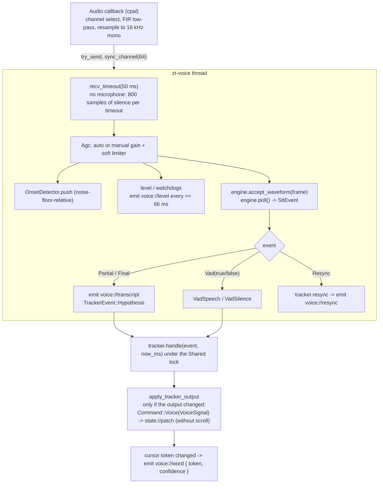

# Data flow, voice pipeline and latency

> Diagrams use Mermaid; see the note on the [Architecture](architecture.md) page. Latency numbers are labeled **measured** (CI runs documented in `docs/research/MODELS.md`), **code** (derived from constants in the source) or **estimated** (not measured on target hardware). Nothing on this page is a guarantee.

## 1. User action to state to windows

```mermaid
sequenceDiagram
    participant K as Key / click / palette (Svelte)
    participant G as Global hotkey (Ctrl+Shift+F6..F11)
    participant C as commands::dispatch
    participant A as appcore::dispatch
    participant S as Shared (mutex): Controller + VoiceTracker
    participant W as Windows (control + talent)
    K->>C: store.send(cmd) -> api.dispatch -> invoke("dispatch")
    G->>A: Command (hotkeys.rs)
    C->>A: dispatch(app, shared, cmd)
    A->>S: lock; Controller::apply(cmd) -> StatePatch
    Note over A,S: script or language changed -> rebuild ScriptIndex, tracker.set_index<br/>tracker-relevant settings changed -> tracker.set_config (cursor kept)<br/>seek (JumpParagraph, SeekToken, ResyncHere, Stop) with voice on -> TrackerEvent::ManualSeek
    A-->>W: emit state://patch (only changed sub-trees, camelCase)
    A-->>W: emit scroll://frame (if scroll changed)
    A->>A: voice toggled -> voice::set_tracking(on)
    A->>A: settings changed -> persist::save_settings
```

Errors returned by `Controller::apply` (for example `ScriptLocked`) are converted to strings and returned to the caller. The frontend shows them as toasts.

## 2. Time

`zt-tick` is the only place where wall-clock time enters the core. It sleeps 16 ms per loop, computes `dt` (clamped to 1..250 ms), applies `Command::Tick(dt)`, and, when voice is enabled, also feeds `TrackerEvent::Tick`. To keep IPC light:

- During the countdown, a `playback` patch is forwarded only when the displayed second changes (or the countdown ends).
- The internal `voice.overrideMs` countdown is reported only once it reaches 0.
- `scroll://frame` carries `position`, `target`, `velocity` (tokens per second, derived from the position delta; 0 when not playing), `playing`, `scriptVersion` and `layoutLines`. Between frames the frontend extrapolates (`lib/scroller.ts`, spring plus prediction) and renders with `requestAnimationFrame`.

The tick rate is measured with `RateCounter` and shown in the diagnostics panel as "Tick Hz" (target about 60).

## 3. Voice pipeline



Key points:

- The audio callback never blocks: `CpalSource` uses `try_lock`, and the app's sink does `try_send` into a channel of capacity 64. If the voice thread falls behind, frames are dropped rather than blocking the audio thread.
- Resampling to 16 kHz mono happens in the callback (`Resampler::to_16k(rate, channels)`), so the voice thread already receives engine-format frames. Gain/AGC is applied afterwards on the voice thread (`Agc::process`, only when a microphone is open).
- Without a microphone (`mic_ok == false`), the loop feeds 800 samples (50 ms) of silence on each timeout so that demo and mock engines keep advancing.
- The tracker is fed only when `tracking` is true. With `tracking = false` (microphone test in onboarding or settings) the thread emits only `voice://level` and `voice://transcript`.
- At start the thread emits `voice://engine` once with `EngineInfo { name, demo, reason, microphone, error, resync, notes, language, audio }`.
- `voice://level` payload: `{ db, rawDb, gainDb }` (level after gain, level of the microphone, applied gain).

### Engine selection (ADR-007, ADR-008)

`voice::make_engine` implements the chain below. There is no silent demo fallback.

1. If the user explicitly chose the Windows speech engine for the language, build it (an error leaves a `NullEngine` and reports `engineError`).
2. Otherwise `models::build_engine`: `Manifest::streaming_plan(language, preferred, usable)` gives the installed streaming models in order (user choice, then `defaultRank`, then installed streaming models of other languages with a note). `build_with_fallback` tries each (`SherpaConfig::nemotron` for models with a language prompt, `SherpaConfig::zipformer` otherwise). If resync is enabled and a resync model is installed, the streaming engine is wrapped in `HybridEngine::with_resync`, with a Silero VAD segmenter when its model exists, otherwise `RmsSegmenter`. Otherwise `HybridEngine::streaming_only`.
3. No streaming model installed: demo engine (`MockEngine::reading` at 2.3 words per second), reason `noModel`. Build without `sherpa`: demo, reason `noSherpa`.
4. A model is installed but fails to load: `NullEngine` (produces nothing), reason `engineError`, error toast.
5. If the result of step 2 or 3 is demo or error and the build has the Windows engine, Windows speech recognition is tried as a fallback; the notes explain why.

After a successful model download a running voice session is restarted (`voice::restart_if_running`).

### Hotwords

The voice thread builds hotwords from the script with `build_hotwords(words, 5, 200, 1.5)` and calls `engine.set_hotwords`. For the shipped manifest this is expected to be a no-op for most models; see [ADR-007](../adr/index.md) (no `bpe.vocab`; Nemotron is greedy-only). The result is logged at info level, never shown as an error.

### Watchdogs and diagnostics

| Watch | Rule |
|---|---|
| `MicWatch` | Report once if 3 s pass with no callback or only exact zeros (typical for the Windows privacy setting for desktop apps) |
| `QuietWatch` | After 10 s, report once if the 90th percentile of raw level blocks is below -50 dBFS (and above -100) |
| `RealtimeWatch` | Per 5 s of audio, compute decode time / audio time. Report once after two consecutive windows with RTF above 0.9 |

All errors go through `diag::report_error` (log, ring buffer of 50, `diag://error` event for a toast). Logging uses `tracing` with the targets `zt::voice`, `zt::engine`, `zt::audio`, `zt::vad`, `zt::stt`, `zt::tracker`, `zt::resync`, `zt::models`, `zt::hotkeys`, `zt::error`, `zt::warn` (and `zt::frontend` for forwarded JavaScript errors per ADR-007). The log directory is `app_log_dir`; files are named `zero-teleprompter.YYYY-MM-DD.log` with daily rotation and 7 files kept. The filter is read from `ZT_LOG` (default `info,zero_teleprompter_lib=debug,zt=debug`). `ZT_STT_DEBUG` enables sherpa's verbose output on stderr.

## 4. Latency chain

Target (ADR-007): word recognized to scroll start below 300 ms at p50, hard limit below 1 s.

### What the app measures (voice thread, rolling last 200 values, nearest-rank percentiles)

| Metric | Start | End | Notes |
|---|---|---|---|
| `onsetToPartial` | Speech onset from `OnsetDetector` (noise-floor relative) | First partial | Includes the model's chunk latency. Also the only latency measured for self-capturing engines |
| `audioToPartial` | Capture time of the audio chunk | Partial emitted | Processing time (queue, gain, decode); excludes the model's internal look-ahead. Not recorded for self-capturing engines |
| `hypToCursor` | Hypothesis handed to the tracker | Cursor changed | Alignment cost. Not recorded for demo or self-capturing engines |
| `endToEnd` | Capture time of the chunk | Cursor-change event handled | Rust side only |

The scroll animation adds time after the tick. The diagnostics panel shows these values as p50/p95.

### Stage budget

| Stage | Value | Kind |
|---|---|---|
| Audio callback period (WASAPI shared, cpal default buffer) | about 10 ms | estimated |
| Channel to voice thread | blocking `recv_timeout`; no polling interval (50 ms is only the abort and silence-feed timeout) | code |
| Resample to 16 kHz | under 1 ms | estimated |
| Model chunk (look-ahead) | see the table below | measured |
| Decode compute per chunk | see `chunk p95` below | measured |
| Tracker (k = 6, w = 70) | under 1 ms (measured per event as `hypToCursor`) | estimated |
| Tick loop | at most 16 ms (`sleep(16 ms)`) | code |
| Scroll ease | `VOICE_EASE_MS = 150`: about 63 % of a cursor step after 150 ms, about 66 % after 160 ms | code and test |
| Endpoint rules (2.4 s / 0.8 s / 20 s) | affect only `Final`; the tracker follows partials | code |

ADR-007's estimate for the whole chain was about 230 ms p50 and about 450 ms p95 with a 320 ms-chunk model. That estimate predates the measurements and was **not** confirmed on target hardware at the time of writing. ADR-007 lists the measurement on Windows ARM64 as an open point.

### Measured model behavior (CI `stt-smoke`, 2026-10-11, run 38132699828)

Setup: real models, 100 ms chunks, 500 ms lead silence, sherpa-onnx 1.13.8, 4-vCPU runners (`ubuntu-22.04`, `windows-latest` x64, `windows-11-arm`). Test audio is a 2.75 s German clip and a 6.6 s English clip. Nemotron ran with 4 threads, Zipformers with 2.

- **RTF** = decode time / audio time (above 1 means slower than real time).
- **Cadence** = audio time between two text changes, i.e. how often the cursor can move.
- **First word** = speech onset in the WAV to the first partial.

| Model | Platform | RTF (DE / EN) | chunk p95 (ms) | Cadence p50 / p95 (s) | First word (DE / EN, s) | Load (ms) | Peak RSS (MB) |
|---|---|---|---|---|---|---|---|
| Nemotron 3.5 320 ms int8 | win-arm64 | 0.31 / 0.32 | 111 to 119 | 0.30 / 0.40 | 0.59 / 0.90 | about 1500 | 774 |
| Nemotron 3.5 320 ms int8 | linux-x64 | 0.59 / 0.59 | 214 | 0.30 / 0.40 | 0.59 / 0.90 | about 1800 | 966 |
| Nemotron 3.5 320 ms int8 | win-x64 | 0.59 / 0.59 | 212 to 214 | 0.30 / 0.40 | 0.59 / 0.90 | about 1700 | 758 |
| Nemotron 3.5 160 ms int8 | win-arm64 | 0.53 / 0.60 | 107 to 126 | 0.20 / 0.30 to 0.40 | 0.59 / 0.90 | about 1500 | 773 |
| Nemotron 3.5 160 ms int8 | linux-x64 | 1.23 / 1.13 | 214 to 281 | 0.20 / 0.30 to 0.50 | 0.59 / 0.90 | about 1800 | 966 |
| Nemotron 3.5 160 ms int8 | win-x64 | 1.05 / 1.11 | 204 to 222 | 0.20 / 0.30 to 0.40 | 0.59 / 0.90 | about 1600 | 760 |
| Kroko DE | win-arm64 | 0.030 / n/a | 0.2 | 1.30 / 1.30 | 0.99 / n/a | about 2800 | 249 |
| Kroko DE | linux-x64 | 0.029 / n/a | 0.3 | 1.30 / 1.30 | 0.99 / n/a | about 2400 | 255 |
| Kroko EN | win-arm64 | n/a / 0.044 | 51 | 1.30 / 1.30 | n/a / 1.00 | about 2800 | 249 |
| Kroko EN | linux-x64 | n/a / 0.041 | 50 | 1.30 / 1.30 | n/a / 2.30 | about 2600 | 257 |
| Zipformer EN 20M int8 | win-arm64 | n/a / 0.031 | 10 | 0.30 / 0.40 | n/a / 1.20 | about 620 | 158 |
| Zipformer EN 20M int8 | linux-x64 | n/a / 0.038 | 12 | 0.30 / 0.40 | n/a / 1.20 | about 530 | 150 |

Findings recorded in `docs/research/MODELS.md` and [ADR-007](../adr/index.md):

- **Kroko's 1.3 s cadence comes from the model, not the app.** The Kroko encoders decode 128 feature frames (1.28 s of audio) per step (`decode_chunk_len = 128` in the encoder metadata). The app already decodes on every audio block and emits a partial on every text change, so nothing can be emitted in between. The 20M Zipformer shows 0.3 s with the same code.
- **Nemotron 160 ms is not real time on the 4-vCPU x86 runners** (RTF 1.05 to 1.23), while 320 ms uses about half the compute everywhere. That is why 320 ms is the default and 160 ms and 80 ms are selectable on strong CPUs.
- **Run-to-run noise on shared runners is large.** The same 160 ms model measured RTF 0.6 to 0.7 on linux-x64 in one run and 2.3 to 2.4 on win-x64 in another. The ratio 160 ms : 320 ms of about 2 : 1 was stable across runs; absolute x86 values were not.
- Without lead silence, Nemotron dropped the first word and the 20M model the first two. With 500 ms of silence (the normal case with an open microphone) all models recognized them.
- sherpa-onnx 1.13.8 implements only `greedy_search` for streaming NeMo transducers, so Nemotron has no hotwords.
- Accuracy on free German speech was not measured; only short test clips were used.

The Windows speech engine (ADR-008) has no latency measurements because CI has no microphone or dictation consent.

## 5. Persistence

| File | Location | Writer | Content |
|---|---|---|---|
| `settings.json` | `app_config_dir` | `persist::save_settings` after every settings patch | `{ "version": 1, "settings": Settings }`. Newer versions are ignored on load |
| `ui-prefs.json` | `app_config_dir` | `set_ui_prefs` command | Free-form JSON of UI-only preferences, broadcast to all windows |
| `voice-models.json` | `app_config_dir` | `models::save_prefs` | Per-language streaming model choice, resync switch and resync model |
| `scripts/<id>.md` | `app_data_dir/scripts` | `save_script` | Script library. `id` must match `[A-Za-z0-9_-]{1,64}` (path traversal guard). Imported text files (`persist::read_text_file`) larger than 8 MiB are refused |
| `models/<model-id>/...` | `app_data_dir/models` | `models::install` | Installed models, plus `unverified-sha256.json` for files the manifest cannot verify |
| `models/manifest.json` | `app_data_dir/models` | user or updater | Optional override of the bundled `resources/models.json` |
| `zero-teleprompter.*.log` | `app_log_dir` | `tracing-appender` | Daily rotation, 7 files kept |

Writes of settings and UI prefs go through `write_atomic` (temporary file, then rename).

## 6. Startup

`run()` initializes logging, loads the settings (falling back to `Settings::from_tokens` on failure), creates the `Controller`, loads an empty script, creates `AppCore` with the stored model preferences, registers `Shared` as Tauri state, starts the tick loop and registers the global hotkeys. The frontend then loads `lastScriptId` or the example script.
